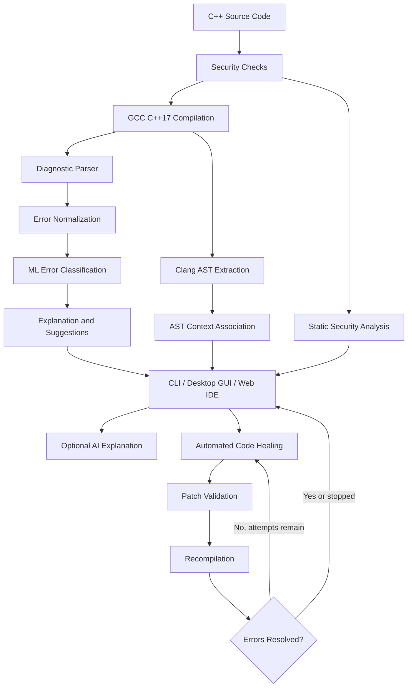

# 🌿 Green Self-Healing Compiler

**An intelligent C++ error explanation, automated repair, AST analysis, and security inspection platform.**

Green Self-Healing Compiler transforms traditional compiler diagnostics into actionable feedback. It combines GCC compilation, machine-learning-based error classification, Clang AST extraction, AI-powered explanations, automated code repair, static security analysis, and code-quality inspection in a unified desktop and web IDE.

The project also includes a security guard subsystem designed to inspect source code, compiler output, AI responses, proposed patches, and HTTP requests before sensitive operations proceed.

---

## Table of Contents

- [Features](#features)
- [System Architecture](#system-architecture)
- [How It Works](#how-it-works)
- [Technology Stack](#technology-stack)
- [Project Structure](#project-structure)
- [Prerequisites](#prerequisites)
- [Installation](#installation)
- [Running the Application](#running-the-application)
- [Command-Line Interface](#command-line-interface)
- [Desktop Application](#desktop-application)
- [Web IDE](#web-ide)
- [AI Configuration](#ai-configuration)
- [Automated Code Repair](#automated-code-repair)
- [Security Analysis](#security-analysis)
- [ML Error Classification](#ml-error-classification)
- [AST Explorer](#ast-explorer)
- [Testing](#testing)
- [Limitations](#limitations)
- [Documentation](#documentation)

---

## Features

### 1. Intelligent Compiler Diagnostics

- Compiles C++ programs using GCC and the C++17 standard.
- Captures and parses compiler errors, warnings, and diagnostic messages.
- Extracts file locations, line numbers, and column information.
- Converts compiler output into structured diagnostic records.
- Provides understandable explanations and suggested corrections.
- Associates diagnostics with relevant AST nodes when AST information is available.

### 2. Machine Learning Error Classification

- Uses a trained scikit-learn classifier to categorize compiler diagnostics.
- Supports a serialized model stored in `data/error_classifier.joblib`.
- Uses training data from `data/training_data.json` when model training is required.
- Combines model-based classification with deterministic rules and fallback handling.
- Supports categories such as syntax errors, type errors, name resolution errors, missing includes, redefinitions, return-type errors, linker errors, and other compiler issues.

### 3. AI-Powered Explanations

- Generates natural-language explanations for compiler errors.
- Provides suggested fixes and the reasoning behind them.
- Supports Gemini and Groq through a unified LLM client.
- Supports batched explanations to reduce repeated API requests.
- Includes offline fallback behavior when AI services are unavailable or disabled.
- Applies security checks to reduce prompt-injection risks.

### 4. Automated Code Healing

- Attempts to repair supported compiler errors automatically.
- Uses deterministic repair rules and AI-generated corrections.
- Recompiles modified source code to validate proposed changes.
- Supports iterative repair attempts with configurable limits.
- Tracks repair outcomes and presents code differences.
- Rejects certain unsafe or invalid patches.
- Preserves backups when the security-healing CLI writes corrected source code.

### 5. Abstract Syntax Tree Explorer

- Extracts AST information through Clang when available.
- Filters compiler-generated and standard-library noise.
- Displays relevant declarations, functions, statements, expressions, and variables.
- Helps associate compiler diagnostics with source-code structure.
- Provides a simplified AST-like fallback in supported workflows when Clang AST extraction is unavailable.

### 6. Security Vulnerability Analysis

- Detects selected unsafe programming patterns and potential C++ vulnerabilities.
- Reports findings with severity, source location, descriptions, and recommendations.
- Identifies categories including buffer overflows, integer overflow, null-pointer dereferences, use-after-free, unsafe string operations, and other memory-safety issues.
- Combines compiler-warning analysis with static source inspection.

### 7. Security Guard Framework

The `src/guard/` package contains specialized security agents for different input and execution stages.

| Component | Responsibility |
|---|---|
| `ExecGuard` | Reviews potentially dangerous process execution and related source patterns. |
| `VulnGuard` | Detects selected programming and memory-safety vulnerabilities. |
| `ResourceGuard` | Checks for potentially excessive resource consumption. |
| `OutputGuard` | Checks output for unsafe terminal and display content. |
| `EndpointGuard` | Validates HTTP requests and detects selected endpoint-abuse patterns. |
| `SecretsGuard` | Checks for exposed credentials and sensitive information. |
| `IntegrityGuard` | Checks model and dataset integrity conditions. |
| `PromptGuard` | Detects selected prompt-injection and instruction-hijacking patterns. |
| `PatchGuard` | Inspects proposed patches for potentially dangerous modifications. |

The framework also provides shared utilities for guarded execution, path validation, resource limits, rate limiting, output handling, and security-healing decisions.

### 8. Code Quality Inspection

- Identifies selected code-quality issues and suspicious programming patterns.
- Produces structured hints and recommendations.
- Displays findings alongside compiler diagnostics and security results.

### 9. Desktop and Web Interfaces

The project provides two interactive interfaces:

- **Desktop IDE:** A PyQt6 application with source editing, compilation, execution, diagnostics, AST exploration, auto-healing, security inspection, and supporting analysis views.
- **Web IDE:** A local HTTP application with a browser-based editor, compilation, AST display, security reporting, automated healing, and program execution.

### 10. Energy and Carbon Telemetry

- Provides energy-related monitoring in the desktop interface.
- Integrates CodeCarbon where supported.
- Includes CPU-load-based estimated energy and carbon calculations in the offline monitor.
- Presents telemetry as estimates rather than guaranteed measurements of actual system power consumption.

---

## System Architecture



The main application modules are organized around several responsibilities:

1. `compiler_runner.py` invokes the compiler and captures diagnostics.
2. `error_parser.py` converts compiler output into structured errors.
3. `error_normalizer.py` standardizes diagnostic messages.
4. `error_classifier.py` assigns error categories.
5. `error_explainer.py` generates explanations and suggestions.
6. `ast_extractor.py` extracts and processes compiler AST output.
7. `security_analyzer.py` reports selected static security findings.
8. `heal_engine.py` coordinates iterative repair.
9. `ai_healer.py` handles AI-assisted source-code correction.
10. `guard/` supplies security review and guarded-execution components.

---

## How It Works

### Step 1: Source Code Input

A user opens a C++ source file through the CLI, desktop application, or web IDE.

### Step 2: Source Inspection

The source is checked against applicable safety rules before compilation or execution.

### Step 3: Compilation

The compiler runner invokes GCC with C++17 support and captures diagnostic output.

### Step 4: Diagnostic Processing

Compiler output is parsed into structured records containing information such as:

- Error type
- Diagnostic message
- File path
- Line and column
- Error category
- Explanation
- Suggested correction
- Security-related metadata

### Step 5: AST Analysis

Clang AST output is processed where available. Relevant AST nodes can provide structural context for individual diagnostics.

### Step 6: Classification and Explanation

The ML classifier, deterministic fallback rules, and explanation modules process the diagnostics. Optional AI assistance can provide additional explanations.

### Step 7: Security and Quality Inspection

The application runs its applicable static checks and produces security findings and code-quality hints.

### Step 8: Automated Repair

When requested, the healing engine proposes corrections, validates changes, and recompiles the modified source within configured attempt limits.

### Step 9: Results

The interface presents the compilation status, diagnostics, suggested corrections, security findings, and repair results.

---

## Technology Stack

| Technology | Purpose |
|---|---|
| Python | Application logic and orchestration |
| C++17 | Source-code analysis and compilation target |
| GCC / `g++` | Compilation and compiler diagnostics |
| Clang / `clang++` | AST extraction |
| scikit-learn | ML-based diagnostic classification |
| Joblib | Serialized model loading |
| PyQt6 | Desktop IDE |
| Python HTTP server | Local web IDE and JSON API |
| Gemini API | Optional AI explanation and healing |
| Groq API | Optional alternative AI provider |
| CodeCarbon | Energy and carbon telemetry integration |
| psutil | CPU-load and system monitoring |
| pytest | Automated test execution |

---

## Project Structure

```text
compiler-error-explanation-ast-nlp/
│
├── .env.example
├── .gitignore
├── README.md
├── DOCUMENTATION.md
├── PBL_Report.md
├── project_explanation.md
├── requirements.txt
├── requirements-dev.txt
│
├── assets/
│   └── favicon_io/
│
├── data/
│   ├── error_classifier.joblib
│   ├── error_classifier_v1_old.joblib
│   ├── error_classifier_v2.joblib
│   ├── training_data.json
│   ├── training_data_original.json
│   ├── v2/
│   └── backup_v1/
│
├── docs/
│   ├── FINAL_VERIFICATION.md
│   ├── SECURITY_ARCHITECTURE.md
│   ├── SECURITY_LIMITATIONS.md
│   ├── gold_set_note.md
│   └── label_definitions.md
│
├── src/
│   ├── main.py
│   ├── gui.py
│   ├── gui_new_pages.py
│   ├── web_server.py
│   ├── compiler_runner.py
│   ├── error_parser.py
│   ├── error_normalizer.py
│   ├── error_classifier.py
│   ├── error_explainer.py
│   ├── ai_explainer.py
│   ├── ai_healer.py
│   ├── llm_client.py
│   ├── ast_extractor.py
│   ├── auto_healer.py
│   ├── heal_engine.py
│   ├── heal_loop.py
│   ├── healing_suggester.py
│   ├── security_analyzer.py
│   ├── security_healer.py
│   ├── security_view.py
│   ├── energy_monitor.py
│   ├── accuracy_benchmark.py
│   ├── quality_hints.py
│   ├── second_opinion.py
│   ├── dataset_logger.py
│   └── guard/
│       ├── __init__.py
│       ├── supervisor.py
│       ├── exec_guard.py
│       ├── vuln_guard.py
│       ├── resource_guard.py
│       ├── output_guard.py
│       ├── endpoint_guard.py
│       ├── secrets_guard.py
│       ├── integrity_guard.py
│       ├── prompt_guard.py
│       ├── patch_guard.py
│       ├── safe_run.py
│       └── ...
│
├── test_cases/
│   ├── mini/
│   └── ...
│
├── tests/
│   ├── test_guard_phase1.py
│   ├── test_guard_phase2.py
│   ├── test_guard_phase3.py
│   ├── test_guard_phase4.py
│   ├── test_guard_phase5.py
│   ├── test_guard_phase6.py
│   ├── test_guard_phase7.py
│   ├── test_guard_phase8a.py
│   ├── test_guard_phase8b.py
│   ├── test_gui_structure.py
│   ├── test_gui_clickthrough.py
│   ├── test_llm_fallback.py
│   └── test_security_docs.py
│
├── tools/
│   ├── verify_all.py
│   ├── verify_explain.py
│   ├── verify_heal.py
│   ├── verify_web.py
│   ├── security_benchmark.py
│   ├── compare_models.py
│   └── ...
│
└── security_bench/
    ├── README.md
    ├── CHANGELOG.md
    └── manifest.json
```

---

## Prerequisites

Install the following before running the application:

- Python 3.10 or newer
- GCC with `g++` and C++17 support
- Clang with `clang++` for the full AST-extraction workflow
- Git
- A supported desktop environment for the PyQt6 GUI

Verify the compiler installations:

```bash
python --version
g++ --version
clang++ --version
```

Clang AST extraction may be unavailable if `clang++` is not installed or cannot process the source. Some workflows provide a simplified fallback.

---

## Installation

### 1. Clone the Repository

```bash
git clone https://github.com/thrishi1011/compiler-error-explanation-ast-nlp.git
cd compiler-error-explanation-ast-nlp
```

### 2. Create a Virtual Environment

**Windows PowerShell:**

```powershell
python -m venv .venv
.\.venv\Scripts\Activate.ps1
```

**Linux / macOS:**

```bash
python3 -m venv .venv
source .venv/bin/activate
```

### 3. Install Dependencies

Install the runtime dependencies:

```bash
python -m pip install --upgrade pip
python -m pip install -r requirements.txt
```

For testing and development:

```bash
python -m pip install -r requirements-dev.txt
```

### 4. Verify the Installation

```bash
python -c "import sklearn, joblib; print('Core ML dependencies are available')"
g++ --version
clang++ --version
```

The project includes model and dataset artifacts under `data/`. Model training is not normally required when the expected serialized model is available.

---

## Running the Application

Run the following commands from the repository root.

### Command-Line Interface

Analyze a C++ file:

```bash
python src/main.py file.cpp
```

Analyze a supplied test case:

```bash
python src/main.py test_cases/mini/tc01_missing_semicolon.cpp
```

Print detailed context and JSON output:

```bash
python src/main.py file.cpp --verbose --json
```

### Desktop Application

```bash
python src/gui.py
```

### Web IDE

```bash
python src/web_server.py
```

Open the following address in your browser:

```text
http://127.0.0.1:8000/
```

To use another port:

```bash
python src/web_server.py 8080
```

Then visit:

```text
http://127.0.0.1:8080/
```

The web server binds to the local loopback interface by default.

---

## Command-Line Interface

The main CLI entry point is `src/main.py`.

### Available Options

| Option | Description |
|---|---|
| `source_file` | C++ source file to analyze |
| `-j`, `--json` | Print structured JSON output |
| `-v`, `--verbose` | Show detailed source-code context |
| `-c`, `--context` | Configure the context-line count; default is 2 |
| `--ai` | Enable AI-powered compiler-error explanations |

### Examples

Human-readable diagnostics:

```bash
python src/main.py test_cases/mini/tc02_undeclared_variable.cpp
```

JSON output:

```bash
python src/main.py file.cpp --json
```

Verbose output with context:

```bash
python src/main.py file.cpp --verbose --context 5
```

Enable AI explanations:

```bash
python src/main.py file.cpp --ai
```

AI features require suitable provider configuration.

The JSON response includes the compilation status, error and warning counts, structured diagnostics, security findings, a security report, guard results, and code-quality information.

---

## Desktop Application

Launch the GUI using:

```bash
python src/gui.py
```

The desktop interface provides a visual environment for working with C++ source code.

Depending on the active feature and available dependencies, the interface includes:

- Code editing and file loading
- Compilation and program execution
- Compiler diagnostics and source context
- Error explanations and repair suggestions
- Automated healing
- AST exploration
- Function and module relationship visualization
- Security findings and review information
- Code-quality hints
- Repair diffs and undo-related workflows
- Benchmark and second-opinion views
- Energy and carbon telemetry
- Light and dark themes

The GUI invokes the supporting modules in `src/` rather than implementing every analysis function independently.

---

## Web IDE

Launch the local HTTP application:

```bash
python src/web_server.py
```

The browser-based IDE communicates with the server through JSON requests.

### Main Endpoints

| Method | Endpoint | Purpose |
|---|---|---|
| `GET` | `/` | Serve the web IDE |
| `POST` | `/api/compile` | Compile and analyze submitted source code |
| `POST` | `/api/heal` | Attempt automated source-code repair |
| `POST` | `/api/run` | Validate, compile, and execute submitted code |

The compilation and analysis workflow can return:

- Diagnostic records
- AST tree data
- Security findings and reports
- Code-quality information
- Processing duration and energy-related telemetry fields

The healing endpoint returns structured repair results. The run endpoint returns program output or information about compilation, timeout, or security rejection.

The endpoint guard checks incoming requests. Requests should be made through the application interface so its request/session requirements can be satisfied.

**Important:** The local execution controls and security checks are not equivalent to operating-system-level sandbox isolation.

---

## AI Configuration

The project supports AI-assisted explanations and source-code repair through Gemini and Groq.

### 1. Create the Environment File

**Windows PowerShell:**

```powershell
Copy-Item .env.example .env
```

**Linux / macOS:**

```bash
cp .env.example .env
```

### 2. Configure the Providers

Add the appropriate values to `.env`:

```dotenv
GEMINI_API_KEY=your_gemini_api_key
GROQ_API_KEY=your_groq_api_key

GEMINI_MODEL=
GROQ_MODEL=
```

Use valid API credentials obtained from the respective providers. Model overrides can be configured where supported; otherwise, the client uses its configured model-selection behavior.

### 3. Enable CLI Explanations

You can explicitly enable AI assistance for the CLI:

```bash
python src/main.py file.cpp --ai
```

Alternatively, set the supported environment variable:

```dotenv
ENABLE_LLM=1
```

Restart the application after changing environment configuration.

### AI Fallback Behavior

The LLM client supports provider fallback, network timeouts, error handling, response processing, and offline fallback behavior. Actual availability depends on credentials, provider access, quotas, and model availability.

**Privacy:** When AI features are used, compiler diagnostics and relevant source-code context may be sent to an external provider. AI healing can send source code for repair. Do not submit confidential source code unless its disclosure is permitted.

**API-key safety:** Never commit `.env` or publish your provider credentials. Keep secrets out of source files, screenshots, and logs.

---

## Automated Code Repair

The repair engine is implemented primarily through:

- `src/heal_engine.py`
- `src/ai_healer.py`
- `src/auto_healer.py`
- `src/heal_loop.py`
- `src/healing_suggester.py`
- `src/diff_viewer.py`

### Repair Workflow

1. Inspect the source and validate it against applicable safety checks.
2. Compile the source or perform a syntax-only check.
3. Parse the compiler diagnostics.
4. Select supported repair rules or attempt AI-assisted correction.
5. Validate the proposed changes.
6. Recompile the corrected source.
7. Compare the resulting diagnostics with the earlier state.
8. Continue within the configured repair limit or return the result.

The engine supports structured statuses such as `healed`, `partially_healed`, and `nothing_changed`.

A proposed fix is not guaranteed to be correct merely because it passes a syntax check. Review changes and test the program's behavior before relying on a repair.

---

## Security Analysis

### Source-Level Vulnerability Analysis

`src/security_analyzer.py` inspects supported source patterns and compiler diagnostics, producing structured findings.

The findings include severity, location, category or vulnerability type, description, and recommendation.

### Security Guard CLI

The separate guard command-line tool is available in `src/guard_cli.py`.

Review a source file:

```bash
python src/guard_cli.py file.cpp --purpose analyze
```

Inspect the source for compilation-related risks:

```bash
python src/guard_cli.py file.cpp --purpose compile
```

Review the source for execution-related risks:

```bash
python src/guard_cli.py file.cpp --purpose run
```

Print a structured JSON verdict:

```bash
python src/guard_cli.py file.cpp --purpose analyze --json
```

### Security-Healing CLI

Request security remediation suggestions:

```bash
python src/guard_cli.py file.cpp --heal-security --json
```

To write an improved result back to the source file:

```bash
python src/guard_cli.py file.cpp --heal-security --write
```

The write operation creates a `.cpp.bak` backup before replacing the source when an improvement is applied.

Review the proposed changes before using them. Behavior-changing fixes require the applicable explicit option.

### Security Limitations

The security guard and parts of the vulnerability analyzer rely on regular expressions and lexical or heuristic analysis. They cannot detect every vulnerability or malicious pattern.

The temporary execution directory, scrubbed process environment, timeouts, and output caps provide additional controls, but **they do not create filesystem or network isolation**. Do not use this application as a security boundary for executing arbitrary untrusted programs.

Read [`docs/SECURITY_ARCHITECTURE.md`](docs/SECURITY_ARCHITECTURE.md) and [`docs/SECURITY_LIMITATIONS.md`](docs/SECURITY_LIMITATIONS.md) for more details.

---

## ML Error Classification

The classifier is implemented in `src/error_classifier.py`.

It loads the configured serialized model and can use the training dataset when model training is required.

Relevant files:

```text
data/
├── error_classifier.joblib
├── training_data.json
├── training_data_original.json
└── v2/
    ├── train.jsonl
    ├── val.jsonl
    ├── test.jsonl
    └── ...
```

Model evaluation and dataset-building utilities are available under `tools/`.

Do not assume that training-set performance represents real-world accuracy. Evaluate changes against separate test data when modifying the classifier or its training process.

---

## AST Explorer

The AST extraction implementation is located in `src/ast_extractor.py`.

The extractor uses Clang AST output and processes the tree to emphasize source-level constructs.

Typical visible node categories include:

- Functions and methods
- Classes and declarations
- Variables and parameters
- Conditional statements
- Loops
- Return statements
- Function calls
- Expressions and literals
- Array access and pointer operations

The desktop and web workflows present AST information in a form that is more readable than the raw compiler dump.

Availability and completeness of AST information depend on the installed compiler and the source being analyzed.

---

## Testing

Install the development requirements first:

```bash
python -m pip install -r requirements-dev.txt
```

Run the automated test suite:

```bash
python -m pytest tests -q
```

Run an individual guard test module:

```bash
python -m pytest tests/test_guard_phase1.py -q
```

Run the GUI structure tests:

```bash
python -m pytest tests/test_gui_structure.py -q
```

Run the AI fallback tests:

```bash
python -m pytest tests/test_llm_fallback.py -q
```

Test results depend on the current environment, installed compilers, dependencies, and configuration.

Additional verification, benchmarking, dataset, and reporting utilities are available in `tools/`.

---

## Limitations

- Compiler diagnostics can vary across GCC and Clang versions.
- AST extraction depends on compiler availability and source compatibility.
- ML classification can produce incorrect predictions, especially for unfamiliar diagnostic patterns.
- AI-generated explanations and repairs may be incorrect or incomplete.
- Static security checks can produce false positives and false negatives.
- Pattern-based security checks can be evaded through transformations they do not recognize.
- AI features may transmit source code and diagnostics to external services.
- Energy and carbon values can be estimated rather than directly measured.
- Guarded execution is not a substitute for a properly isolated sandbox.

Use the application as a development and learning aid, and independently validate important code changes and security conclusions.

---

## Documentation

Additional project documentation is available here:

- [Technical Documentation](DOCUMENTATION.md)
- [Project Explanation and Architecture](project_explanation.md)
- [Project-Based Learning Report](PBL_Report.md)
- [Security Architecture](docs/SECURITY_ARCHITECTURE.md)
- [Security Limitations](docs/SECURITY_LIMITATIONS.md)
- [Final Verification Report](docs/FINAL_VERIFICATION.md)
- [Security Benchmark Documentation](security_bench/README.md)

---

## Repository

Source code and project files:

https://github.com/thrishi1011/compiler-error-explanation-ast-nlp
