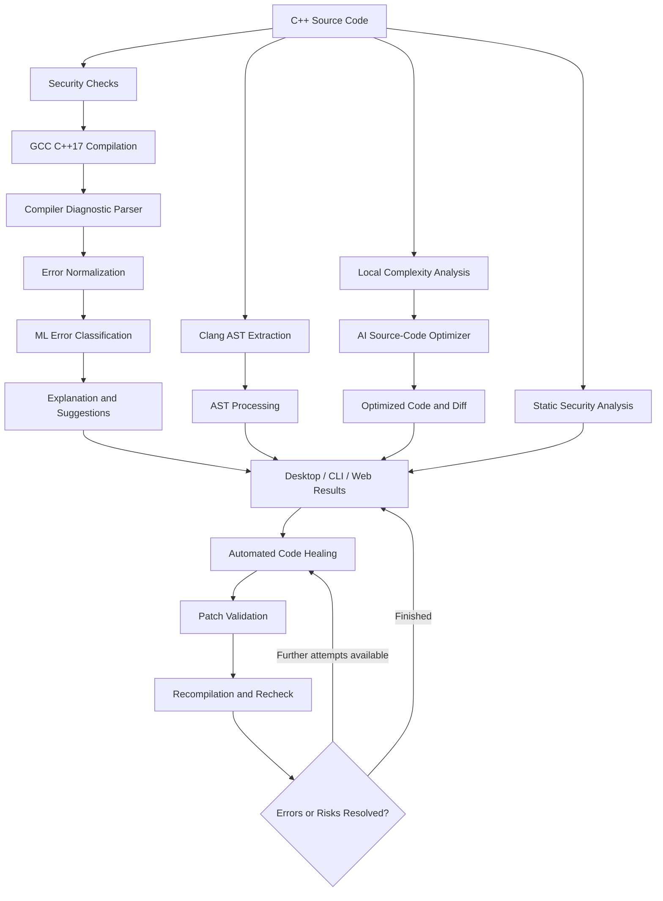

# 🌿 Green Self-Healing Compiler

**An AI-assisted C++ development environment for compiler-error explanation, automated code repair, algorithmic optimization, AST visualization, and security analysis.**

Green Self-Healing Compiler brings several C++ development tools together in one application. It combines GCC compilation, machine-learning-based error classification, AI-powered explanations, automated source-code repair, time and space complexity analysis, AI-assisted code optimization, Abstract Syntax Tree (AST) exploration, and security inspection.

The project provides a **PyQt6 desktop IDE**, a **local browser-based IDE**, and command-line tools. Its analysis pipeline helps developers understand compilation failures, investigate potentially unsafe code, identify performance bottlenecks, and apply improvements while retaining the ability to review changes.

---

## Table of Contents

- [Overview](#overview)
- [Features](#features)
- [AI-Assisted Code Optimization](#ai-assisted-code-optimization)
- [System Architecture](#system-architecture)
- [How It Works](#how-it-works)
- [Technology Stack](#technology-stack)
- [Project Structure](#project-structure)
- [Prerequisites](#prerequisites)
- [Installation](#installation)
- [Running the Application](#running-the-application)
- [Command-Line Interface](#command-line-interface)
- [Desktop Application](#desktop-application)
- [Web IDE](#web-ide)
- [AI Configuration](#ai-configuration)
- [Automated Code Healing](#automated-code-healing)
- [Compiler Error Classification](#compiler-error-classification)
- [AST Explorer](#ast-explorer)
- [Security Analysis and Guard Framework](#security-analysis-and-guard-framework)
- [Security Healing](#security-healing)
- [Code Quality Analysis](#code-quality-analysis)
- [Energy and Carbon Telemetry](#energy-and-carbon-telemetry)
- [Testing](#testing)
- [Limitations and Responsible Use](#limitations-and-responsible-use)
- [Documentation](#documentation)

---

## Overview

Traditional compiler diagnostics often require developers to search through error messages, identify the underlying cause, and manually correct their source code. This project extends that workflow by combining conventional compilation with machine learning, AI assistance, code analysis, automated repair, and security checks.

The application is designed to help developers:

- Understand C++ compiler errors and warnings.
- Classify common compiler diagnostic categories.
- Receive explanations and possible corrections.
- Repair supported compilation errors through automated healing.
- Analyze algorithmic time and space complexity.
- Generate AI-assisted source-code optimizations.
- Compare original and optimized source code.
- Explore the structure of C++ programs through AST visualization.
- Identify selected security vulnerabilities and unsafe programming patterns.
- Review suggested changes before incorporating them into their code.

The application is a development and learning aid. Compilation success, an AI-generated suggestion, or a clean security report does not guarantee that a program is correct, efficient, or free of vulnerabilities.

---

## Features

### 1. C++ Compilation and Diagnostics

The compiler pipeline uses GCC's `g++` compiler with C++17 support.

Features include:

- Compilation of C++ source files.
- Capture and parsing of compiler diagnostics.
- Extraction of source locations, including file paths, line numbers, and available column information.
- Structured representations of errors and warnings.
- Explanations and suggested corrections for recognized errors.
- Contextual diagnostic information for the desktop, web, and command-line interfaces.
- Compiler-warning analysis and security-aware compilation checks.

The regular compilation command uses C++17 and warning flags. The separate AI-assisted optimization feature is described below.

### 2. Machine Learning Error Classification

The project includes an ML-based classifier for compiler diagnostics.

- Uses a trained scikit-learn model.
- Supports a serialized classifier stored under `data/`.
- Uses TF-IDF and Logistic Regression in the classifier workflow.
- Combines model predictions with rule-based classification and fallback handling.
- Handles common categories such as syntax errors, type errors, undeclared names, missing includes, redefinitions, return-type errors, and other compiler issues.

The classifier's output is a prediction, not a guarantee of the error's true cause. Results can vary for unfamiliar diagnostics and source-code patterns.

### 3. AI-Powered Explanations

AI assistance can help translate compiler diagnostics into explanations that are easier to understand.

Depending on the selected workflow and available provider configuration, features include:

- Natural-language explanations of compiler errors.
- Suggested corrections and supporting reasoning.
- Integration with Gemini and Groq through a shared LLM client.
- Provider-specific configuration and model selection.
- Request timeouts, response processing, error handling, and fallback behavior.
- Guard checks intended to reduce selected prompt-injection and unsafe-input risks.

AI availability depends on API credentials, network access, provider quotas, and model availability.

### 4. AI-Assisted Code Optimization

The desktop application includes a dedicated **Optimise Code** feature.

It combines local source-code heuristics with AI-assisted analysis to help identify inefficient algorithmic patterns and generate a potentially improved C++ implementation.

The optimizer can provide:

- Estimated time complexity before and after optimization.
- Estimated space complexity before and after optimization.
- Potential algorithmic bottlenecks and their reported severity.
- A list of suggested optimizations.
- AI-generated optimized C++ source code when the required provider is available.
- A comparison of the original and proposed source code.
- An option to apply changed code to the editor.
- A security recheck after an optimization is applied.

See [AI-Assisted Code Optimization](#ai-assisted-code-optimization) for the complete workflow, configuration, and limitations.

### 5. Automated Code Healing

The self-healing pipeline attempts to fix supported compilation errors.

- Uses deterministic repair rules and AI-assisted corrections.
- Validates proposed changes using compiler feedback.
- Recompiles corrected source to assess whether the errors were resolved.
- Supports multiple repair rounds within configured limits.
- Tracks repair attempts, outcomes, and code differences.
- Avoids accepting selected patches that fail applicable security or validation checks.
- Supports healing-related backup and undo workflows in the desktop application.

Possible outcomes include `healed`, `partially_healed`, and `nothing_changed`.

### 6. Abstract Syntax Tree Explorer

The application uses Clang AST output where available and transforms it into a more readable representation.

It can help explore source-level constructs such as:

- Functions and methods.
- Classes and declarations.
- Variables and parameters.
- Conditional statements and loops.
- Return statements and function calls.
- Expressions and literals.
- Array access and pointer operations.

AST availability and completeness depend on the installed Clang toolchain and source-code compatibility. Supported workflows can use a simplified fallback representation when full AST extraction is unavailable.

### 7. Security Vulnerability Analysis

The security analysis pipeline examines selected source-code patterns and compiler diagnostics.

Depending on the analyzed code and enabled checks, findings may cover:

- Unsafe string and buffer operations.
- Potential buffer overflows.
- Integer-overflow patterns.
- Null-pointer dereferences.
- Use-after-free and memory-lifetime issues.
- Resource-exhaustion patterns.
- Potentially dangerous process-execution operations.
- Other supported vulnerability and code-safety patterns.

Findings can include severity, source location, description, category, and recommended action.

### 8. Security Guard Framework

The `src/guard/` package provides security checks and utilities used across selected compilation, healing, execution, AI, and web-request workflows.

| Component | Responsibility |
|---|---|
| `ExecGuard` | Reviews selected process-execution risks and dangerous source patterns. |
| `VulnGuard` | Detects supported vulnerability and memory-safety patterns. |
| `ResourceGuard` | Checks for potentially excessive resource use. |
| `OutputGuard` | Reviews output for selected unsafe display or terminal content. |
| `EndpointGuard` | Checks HTTP requests and selected endpoint-abuse patterns. |
| `SecretsGuard` | Checks for exposed credentials and sensitive information. |
| `IntegrityGuard` | Checks model and dataset integrity conditions. |
| `PromptGuard` | Detects selected prompt-injection and instruction-hijacking patterns. |
| `PatchGuard` | Inspects proposed patches for potentially dangerous modifications. |

Shared components also provide guarded process execution, path checks, resource limits, rate limiting, output handling, and security-related repair decisions.

### 9. Program Execution

The desktop and web workflows support running eligible C++ programs.

The execution path includes selected security checks and controls such as timeouts, temporary directories, environment handling, and output limits.

The execution controls are intended to reduce risk. They do not provide full operating-system-level sandbox isolation.

### 10. Code Quality Analysis

The code-quality module identifies selected code-quality concerns and suspicious patterns.

Quality hints are presented alongside other analysis results to help developers review their code beyond compilation status.

### 11. Desktop and Web Interfaces

The project offers two interactive interfaces:

- **Desktop IDE:** Source editing, compilation, execution, diagnostics, healing, code optimization, AST exploration, security scanning, and supporting analysis views.
- **Web IDE:** A local browser interface for editing, compilation, AST and security results, automated healing, and program execution.

The desktop interface also includes supporting views for function and control-flow relationships, classifier comparison, security information, repair differences, and telemetry.

---

## AI-Assisted Code Optimization

The source-code optimizer is implemented primarily in:

- `src/optimizer.py`
- `src/complexity_analyzer.py`
- `src/optimization_view.py`
- `src/llm_client.py`
- `src/gui.py`

### What does the optimizer do?

The optimizer analyzes the structure of C++ source code, estimates its complexity, identifies potential bottlenecks, and can use an AI provider to propose a revised implementation.

It aims to improve algorithmic efficiency and memory usage while preserving the original program's behavior and security hardening.

The result can include:

| Output | Description |
|---|---|
| Original time complexity | Estimated complexity before optimization. |
| Optimized time complexity | Complexity reported for the proposed implementation. |
| Original space complexity | Estimated memory complexity before optimization. |
| Optimized space complexity | Complexity reported for the proposed implementation. |
| Bottlenecks | Potential performance issues, with available line numbers and severity. |
| Optimizations applied | Explanations of changes reported by the optimizer. |
| Optimized source code | The proposed C++ implementation. |
| Diff view | A line-by-line comparison between the original and proposed code. |
| Security status | A status reported by the optimization workflow, followed by security rechecking in the GUI. |

### How does the optimization workflow work?

1. **Select source code.** Open a C++ file in the desktop IDE or edit the source in the editor.

2. **Start optimization.** Click **Optimise Code**.

3. **Analyze the code locally.** The complexity analyzer uses heuristics to detect patterns such as nested loops, recursion, sorting, containers passed by value, and large fixed-size arrays.

4. **Request AI optimization.** When the required Groq API configuration is available, the optimizer sends the source and preliminary analysis to the AI client for more detailed analysis and a proposed rewrite.

5. **Review the complexity results.** The optimizer presents reported time and space complexity, explanations, bottlenecks, and optimizations.

6. **Review the proposed source.** The desktop interface displays the optimized code and a diff comparing it with the original implementation.

7. **Apply the result.** The current desktop workflow applies changed optimized code to the editor when a different optimized result is returned.

8. **Recheck security.** The desktop optimization workflow runs security checks on the resulting code and reports any findings.

9. **Compile and test.** Use the regular Compile and Run workflows to validate the proposed implementation. Review the diff and confirm that the program still behaves correctly.

### Example of the optimization goal

Consider a program that searches for two values in an array by comparing every possible pair.

A straightforward approach may involve nested loops and therefore have quadratic time complexity, \(O(n^2)\), in the number of elements.

A suitable algorithmic alternative may use a hash-based lookup to reduce expected search time to \(O(n)\), subject to the problem's constraints and implementation details.

The optimizer is intended to help identify opportunities like this. Whether an alternative is appropriate depends on the specific program; an AI-generated rewrite is not guaranteed to produce an improvement.

### Is the optimized code applied automatically?

In the current desktop implementation, a changed optimization result is applied to the editor after the optimization workflow completes. The application also updates its complexity and result views and performs security checks.

**Review the changed code before saving it or relying on it.** Do not assume that applying a result means it has been formally proven equivalent to the original program.

### Does code optimization require an API key?

The optimizer uses a local heuristic scan and Groq-based AI optimization.

Create a `.env` file using the instructions in [AI Configuration](#ai-configuration), then set:

```dotenv
GROQ_API_KEY=your_groq_api_key
```

Without an available Groq key, the current optimizer can still return heuristic complexity information and potential bottlenecks. Its offline fallback returns the original source code unchanged and does not generate a new optimized implementation.

### Important distinction: source optimization vs. compiler optimization flags

The **Optimise Code** feature is an AI-assisted source-code optimization workflow. It proposes changes to the C++ source itself.

The ordinary compiler command currently uses C++17 and warning flags such as `-Wall`, `-Wextra`, `-Wshadow`, and `-Wnull-dereference`. It does not currently enable GCC's `-O2` or `-O3` optimization flags in that command.

These are different mechanisms:

- **Source-code optimization:** proposes changes to the program's C++ implementation.
- **Compiler optimization flags:** ask GCC to optimize the generated machine code during compilation.

The project currently provides the former through its dedicated optimizer interface.

---

## System Architecture

The application combines diagnostic processing, AST extraction, ML classification, code optimization, automated healing, and security review.



### Main module responsibilities

| Module | Responsibility |
|---|---|
| `src/main.py` | Command-line entry point and main analysis pipeline. |
| `src/compiler_runner.py` | GCC invocation, compiler output capture, and compilation-related checks. |
| `src/error_parser.py` | Converts compiler output into structured diagnostic records. |
| `src/error_normalizer.py` | Standardizes diagnostic messages. |
| `src/error_classifier.py` | ML and rule-assisted diagnostic classification. |
| `src/error_explainer.py` | Explanations and suggested corrections. |
| `src/ai_explainer.py` | AI-assisted compiler-error explanations. |
| `src/llm_client.py` | AI-provider integration and request handling. |
| `src/ast_extractor.py` | AST extraction and source-structure processing. |
| `src/complexity_analyzer.py` | Local heuristic complexity analysis. |
| `src/optimizer.py` | Complexity analysis orchestration and AI-assisted code optimization. |
| `src/optimization_view.py` | Transforms optimizer results into display-ready data. |
| `src/heal_engine.py` | Main automated healing workflow. |
| `src/ai_healer.py` | AI-assisted source-code repair. |
| `src/auto_healer.py` | Rule-based repairs for supported errors. |
| `src/security_analyzer.py` | Static vulnerability and diagnostic analysis. |
| `src/security_healer.py` | Security-related repair suggestions and remediation workflow. |
| `src/security_view.py` | Security results and guard-result presentation helpers. |
| `src/guard/` | Security guards, validation, limits, and guarded execution utilities. |
| `src/quality_hints.py` | Code-quality analysis and hints. |
| `src/energy_monitor.py` | Energy and carbon telemetry support. |
| `src/web_server.py` | Local HTTP server and browser-based IDE endpoints. |
| `src/gui.py` | Main desktop IDE and its integration with the analysis modules. |

---

## How It Works

### Compilation and explanation workflow

1. A user opens or supplies a C++ source file.
2. Applicable security checks inspect the source.
3. GCC compiles the code and returns diagnostic output.
4. The parser converts diagnostics into structured records.
5. The classifier identifies likely error categories.
6. The explanation workflow generates descriptions and possible fixes.
7. Clang AST information is extracted where available.
8. Static security analysis and code-quality checks produce additional findings.
9. The interface displays the results.

### Optimization workflow

1. The user invokes **Optimise Code** in the desktop interface.
2. Local heuristics estimate complexity and identify selected source patterns.
3. The optimizer requests AI analysis through the configured optimization provider when available.
4. The result includes reported complexity, potential bottlenecks, and a proposed C++ implementation.
5. The interface displays the result and differences from the original source.
6. The desktop workflow applies a changed result to the editor and rechecks security.
7. The user reviews, compiles, and tests the resulting source.

### Healing workflow

1. The source is checked and compiled or syntax-checked.
2. Compiler errors and supported warnings are identified.
3. Applicable deterministic or AI-assisted repair methods propose changes.
4. Security and patch checks evaluate proposed changes.
5. The source is checked again through compiler feedback.
6. Additional rounds may run within the configured limits.
7. The application reports the resulting status and remaining issues.

---

## Technology Stack

| Technology | Purpose |
|---|---|
| Python | Application logic, analysis, and orchestration. |
| C++17 | Supported source-code compilation target. |
| GCC / `g++` | Compilation and compiler diagnostics. |
| Clang / `clang++` | AST extraction. |
| scikit-learn | Machine-learning-based diagnostic classification. |
| Joblib | Loading serialized ML models. |
| PyQt6 | Desktop application. |
| Python HTTP server | Local web IDE and JSON API. |
| Gemini API | Optional AI explanation and healing workflows. |
| Groq API | AI-assisted source-code optimization and supported AI workflows. |
| CodeCarbon | Energy and carbon telemetry integration. |
| psutil | CPU-load and system monitoring. |
| pytest | Automated testing. |

---

## Project Structure

The following shows the principal files and directories relevant to the application. Additional datasets, security tests, benchmark files, assets, and support utilities are present in the repository.

```text
compiler-error-explanation-ast-nlp/
│
├── README.md
├── DOCUMENTATION.md
├── PBL_Report.md
├── project_explanation.md
├── requirements.txt
├── requirements-dev.txt
├── .env.example
│
├── data/
│   ├── error_classifier.joblib
│   ├── training_data.json
│   ├── training_data_original.json
│   ├── model_manifest.json
│   ├── model_metrics.json
│   └── v2/
│
├── docs/
│   ├── FINAL_VERIFICATION.md
│   ├── SECURITY_ARCHITECTURE.md
│   └── SECURITY_LIMITATIONS.md
│
├── src/
│   ├── main.py
│   ├── gui.py
│   ├── gui_new_pages.py
│   ├── web_server.py
│   ├── compiler_runner.py
│   │
│   ├── error_parser.py
│   ├── error_normalizer.py
│   ├── error_classifier.py
│   ├── error_explainer.py
│   ├── ai_explainer.py
│   ├── llm_client.py
│   │
│   ├── ast_extractor.py
│   ├── complexity_analyzer.py
│   ├── optimizer.py
│   ├── optimization_view.py
│   │
│   ├── auto_healer.py
│   ├── ai_healer.py
│   ├── heal_engine.py
│   ├── heal_loop.py
│   ├── healing_suggester.py
│   ├── security_healer.py
│   │
│   ├── security_analyzer.py
│   ├── security_view.py
│   ├── quality_hints.py
│   ├── energy_monitor.py
│   ├── accuracy_benchmark.py
│   ├── dataset_logger.py
│   │
│   ├── guard_cli.py
│   └── guard/
│       ├── supervisor.py
│       ├── exec_guard.py
│       ├── vuln_guard.py
│       ├── resource_guard.py
│       ├── output_guard.py
│       ├── endpoint_guard.py
│       ├── secrets_guard.py
│       ├── integrity_guard.py
│       ├── prompt_guard.py
│       ├── patch_guard.py
│       ├── safe_run.py
│       └── ...
│
├── test_cases/
├── tests/
├── tools/
└── security_bench/
```

---

## Prerequisites

Install the following before running the application:

- Python 3.10 or newer.
- GCC with `g++` and C++17 support.
- Clang with `clang++` for full AST extraction.
- Git.
- A supported desktop environment for the PyQt6 application.

Verify the toolchain:

```bash
python --version
g++ --version
clang++ --version
```

If `clang++` is missing or cannot process the source, full AST extraction may be unavailable. Some workflows provide a simplified fallback.

AI features require additional API configuration. The core compilation and local heuristic analysis do not require an AI provider to be available.

---

## Installation

### 1. Clone the repository

```bash
git clone https://github.com/thrishi1011/compiler-error-explanation-ast-nlp.git
cd compiler-error-explanation-ast-nlp
```

### 2. Create a virtual environment

**Windows PowerShell**

```powershell
python -m venv .venv
.\.venv\Scripts\Activate.ps1
```

**Linux / macOS**

```bash
python3 -m venv .venv
source .venv/bin/activate
```

### 3. Install dependencies

```bash
python -m pip install --upgrade pip
python -m pip install -r requirements.txt
```

For testing and development:

```bash
python -m pip install -r requirements-dev.txt
```

### 4. Verify core dependencies

```bash
python -c "import sklearn, joblib; print('Core ML dependencies are available')"
g++ --version
clang++ --version
```

The repository includes serialized model and dataset artifacts under `data/`. Retraining the classifier is not normally required when the expected model artifact is available.

---

## Running the Application

Run the commands from the repository root.

### Command-line analysis

```bash
python src/main.py file.cpp
```

Analyze a supplied test case:

```bash
python src/main.py test_cases/mini/tc01_missing_semicolon.cpp
```

Print detailed context and JSON output:

```bash
python src/main.py file.cpp --verbose --json
```

### Desktop IDE

```bash
python src/gui.py
```

Open a source file in the IDE, then use the available controls to compile, run, explain errors, heal supported issues, explore AST information, inspect security findings, and optimize code.

### Web IDE

```bash
python src/web_server.py
```

Open:

```text
http://127.0.0.1:8000/
```

To use a different port:

```bash
python src/web_server.py 8080
```

Then visit:

```text
http://127.0.0.1:8080/
```

The web server binds to the local loopback interface by default.

---

## Command-Line Interface

The main command-line entry point is `src/main.py`.

### Supported options

| Option | Description |
|---|---|
| `source_file` | C++ source file to analyze. |
| `-j`, `--json` | Print structured JSON output. |
| `-v`, `--verbose` | Display detailed source context. |
| `-c`, `--context` | Set the number of context lines; default is `2`. |
| `--ai` | Enable AI-powered compiler-error explanations. |

### Examples

Human-readable diagnostics:

```bash
python src/main.py test_cases/mini/tc02_undeclared_variable.cpp
```

JSON output:

```bash
python src/main.py file.cpp --json
```

Verbose output with five context lines:

```bash
python src/main.py file.cpp --verbose --context 5
```

Enable AI explanations:

```bash
python src/main.py file.cpp --ai
```

The analysis pipeline can return compilation status, error and warning counts, structured diagnostics, security findings and reports, guard results, and code-quality information.

The source-code optimizer is a separate desktop workflow; it is not exposed as a documented `src/main.py` command-line option in the current implementation.

---

## Desktop Application

Launch the desktop interface:

```bash
python src/gui.py
```

The desktop IDE provides the following functionality through its interface and supporting modules:

- Load and edit C++ source files.
- Compile source code and inspect diagnostics.
- Run eligible programs.
- Review explanations and suggestions.
- Use the Auto-Heal workflow.
- Undo supported healing changes.
- Analyze and optimize code using the dedicated optimizer.
- View time and space complexity estimates.
- Inspect bottlenecks, proposed optimizations, and source-code differences.
- Explore AST, call graph, and control-flow information.
- Review security findings and guard results.
- Compare error-classification methods.
- Inspect code-quality hints and other analysis information.
- View energy and carbon telemetry.
- Switch between supported light and dark themes.

The desktop interface integrates the supporting analysis modules rather than independently implementing every compiler, optimization, and security operation.

---

## Web IDE

Start the local HTTP application:

```bash
python src/web_server.py
```

Open `http://127.0.0.1:8000/` in a browser.

### Main endpoints

| Method | Endpoint | Purpose |
|---|---|---|
| `GET` | `/` | Serves the web IDE. |
| `POST` | `/api/compile` | Compiles and analyzes submitted source code. |
| `POST` | `/api/heal` | Attempts automated source-code repair. |
| `POST` | `/api/run` | Validates, compiles, and executes eligible submitted code. |

The compilation workflow can return diagnostic records, AST tree data, security findings and reports, quality hints, and processing telemetry fields.

The healing endpoint returns structured repair results. The run endpoint returns program output or information about compilation failures, timeouts, and security rejections.

The endpoint guard checks incoming requests. Use the web interface so the application can supply the expected request/session information.

**Current scope:** The documented web endpoints cover compilation, healing, and execution. The AI-assisted code-optimization workflow described above is currently integrated into the desktop application.

---

## AI Configuration

AI-assisted explanations, healing, and source-code optimization require provider-specific configuration.

### 1. Create the environment file

**Windows PowerShell**

```powershell
Copy-Item .env.example .env
```

**Linux / macOS**

```bash
cp .env.example .env
```

### 2. Configure API credentials

Add the appropriate credentials to `.env`:

```dotenv
GEMINI_API_KEY=your_gemini_api_key
GROQ_API_KEY=your_groq_api_key

GEMINI_MODEL=
GROQ_MODEL=
```

Obtain valid credentials directly from the respective providers. Leave model overrides empty to use the application's configured model-selection behavior.

### 3. Enable CLI explanations

```bash
python src/main.py file.cpp --ai
```

The application also supports the following environment setting in relevant AI workflows:

```dotenv
ENABLE_LLM=1
```

Restart the application after changing environment configuration.

### AI availability and fallback behavior

AI requests can fail because of missing or invalid credentials, quotas, provider outages, network errors, timeouts, or unavailable models.

The LLM client contains provider-specific request handling and fallback logic. However, behavior differs by feature: the optimizer's offline fallback provides heuristic results and returns the original source code unchanged instead of generating an AI rewrite.

### Privacy and API-key safety

When AI features are used, compiler diagnostics, source-code context, or source code itself may be sent to an external provider, depending on the operation.

Do not submit confidential or sensitive source code unless its disclosure is permitted.

Never commit `.env` or publish API credentials. Keep secrets out of source files, screenshots, and logs.

---

## Automated Code Healing

The healing workflow is implemented primarily in:

- `src/heal_engine.py`
- `src/ai_healer.py`
- `src/auto_healer.py`
- `src/heal_loop.py`
- `src/healing_suggester.py`
- `src/security_healer.py`

### Repair workflow

1. Inspect the current source and applicable safety checks.
2. Compile the source or perform a syntax-only check.
3. Parse and classify compiler diagnostics.
4. Select a supported deterministic repair or attempt AI-assisted correction.
5. Validate the proposed patch.
6. Recheck compiler errors and warnings.
7. Reject selected changes that fail applicable security or validation requirements.
8. Continue within configured repair limits or return the outcome.

The engine tracks repair attempts and can report statuses such as:

- `healed`
- `partially_healed`
- `nothing_changed`

The security-healing workflow separately analyzes supported security issues and may propose code modifications.

Passing a syntax check does not prove that a repaired program behaves correctly. Review the diff and run appropriate tests before relying on a repair.

---

## Compiler Error Classification

The classifier is implemented in `src/error_classifier.py`.

It loads the configured serialized ML model and supports the associated training data and dataset utilities.

Relevant files include:

```text
data/
├── error_classifier.joblib
├── training_data.json
├── training_data_original.json
└── v2/
    ├── train.jsonl
    ├── val.jsonl
    ├── test.jsonl
    └── ...
```

The project combines ML-based diagnostic classification with rule-based and fallback mechanisms.

Evaluation scores can depend on the dataset, training process, and compiler version. Training-set performance should not be treated as a reliable estimate of accuracy on unfamiliar real-world diagnostics.

---

## AST Explorer

AST extraction is implemented in `src/ast_extractor.py`.

The extractor uses Clang AST output and processes the tree to emphasize source-level constructs.

Common visible node types include:

- Functions and methods.
- Classes and declarations.
- Variables and parameters.
- Conditional statements.
- Loops.
- Return statements.
- Function calls.
- Expressions and literals.
- Array access and pointer operations.

The desktop and web workflows present supported AST information in a form intended to be easier to explore than raw compiler output.

AST availability and completeness depend on the installed compiler and source compatibility.

---

## Security Analysis and Guard Framework

### Source-level vulnerability analysis

`src/security_analyzer.py` inspects supported source patterns and compiler diagnostics.

Findings may include:

- Severity and location.
- Category or vulnerability type.
- Description of the detected pattern.
- Suggested remediation.
- Related diagnostic information, when available.

The desktop interface provides a Security view for reviewing findings and related guard results.

### Guard command-line interface

The security guard CLI is available in `src/guard_cli.py`.

Review a source file:

```bash
python src/guard_cli.py file.cpp --purpose analyze
```

Inspect compilation-related risks:

```bash
python src/guard_cli.py file.cpp --purpose compile
```

Review execution-related risks:

```bash
python src/guard_cli.py file.cpp --purpose run
```

Print a structured JSON verdict:

```bash
python src/guard_cli.py file.cpp --purpose analyze --json
```

### Security checks during optimization

The desktop optimization workflow rechecks the source after applying an optimization result. Security findings may still be reported, and the user should review them before saving or executing the modified code.

A status reported by an AI optimizer is not a substitute for the application's security analysis or independent code review.

---

## Security Healing

The security healer is implemented in `src/security_healer.py`.

Request security-remediation suggestions:

```bash
python src/guard_cli.py file.cpp --heal-security --json
```

To write an improved result back to the source file:

```bash
python src/guard_cli.py file.cpp --heal-security --write
```

The write operation creates a `.cpp.bak` backup before replacing the source when an improvement is applied.

Review proposed changes before using them. Behavior-changing fixes require the applicable explicit option.

Security repairs may be incomplete, and changes that require human judgment can remain unresolved.

---

## Code Quality Analysis

The module `src/quality_hints.py` provides code-quality analysis.

It identifies selected code-quality concerns and produces structured hints or recommendations. Quality information is used alongside compiler diagnostics and security findings in supported workflows.

Code-quality hints are advisory; they are not a complete static-analysis proof of correctness or maintainability.

---

## Energy and Carbon Telemetry

The project includes energy-related monitoring through `src/energy_monitor.py`.

Depending on the environment and available measurement support, the application may display:

- Processing duration.
- CPU-load-related estimates.
- Energy-related telemetry.
- Estimated carbon-emissions information.
- Action-level monitoring for supported workflows.

CodeCarbon is integrated where supported, while some fallback calculations estimate energy or emissions from system activity.

**Telemetry values should be treated as estimates when direct measurement is unavailable.** They should not be interpreted as guaranteed measurements of actual system power consumption or precise carbon emissions.

---

## Testing

Install the development requirements:

```bash
python -m pip install -r requirements-dev.txt
```

Run the test suite:

```bash
python -m pytest tests -q
```

Run an individual security guard test module:

```bash
python -m pytest tests/test_guard_phase1.py -q
```

Run GUI structure tests:

```bash
python -m pytest tests/test_gui_structure.py -q
```

Run AI fallback tests:

```bash
python -m pytest tests/test_llm_fallback.py -q
```

The current tests cover selected guard, GUI, healing, AI fallback, security documentation, and related behavior. The exact coverage depends on the current test files.

For changes to the optimizer, verify both AI-enabled and offline behavior, inspect the generated diff, compile the resulting source, and test its expected behavior. API-dependent tests may require appropriate credentials and network access.

Test outcomes depend on the environment, installed compilers, dependencies, and configuration.

Additional verification, benchmarking, dataset-building, and reporting utilities are available under `tools/` and `security_bench/`.

---

## Limitations and Responsible Use

- Compiler diagnostics can vary across GCC versions and environments.
- AST extraction depends on Clang availability and source compatibility.
- ML classification may misclassify unfamiliar diagnostic patterns.
- Local complexity analysis uses heuristics and may not accurately capture every algorithm's true asymptotic complexity.
- AI-reported complexity estimates and optimization claims are not formal proofs.
- AI-generated optimized code may be incorrect, incomplete, or slower for some inputs.
- An optimization that improves one workload may worsen another.
- The offline optimizer fallback does not generate a new implementation; it returns the original source with heuristic analysis.
- AI-generated explanations and healing suggestions may be incorrect.
- Static security checks can produce false positives and false negatives.
- Pattern-based checks can miss attacks or vulnerabilities that use unrecognized transformations.
- Security rechecks do not prove that a program is vulnerability-free.
- AI features can transmit source code and diagnostic information to external services.
- Energy and carbon values may be estimated rather than directly measured.
- Temporary directories, environment handling, timeouts, and output caps provide additional execution controls, but they do not create full filesystem or network isolation.

**Before accepting a change, review the diff, compile the code, run relevant tests, and confirm the program's behavior.** Do not treat this application as a substitute for comprehensive testing, professional security review, or a properly isolated execution sandbox.

---

## Documentation

Additional documentation is available in the repository:

- [Technical Documentation](DOCUMENTATION.md)
- [Project Explanation and Architecture](project_explanation.md)
- [Project-Based Learning Report](PBL_Report.md)
- [Security Architecture](docs/SECURITY_ARCHITECTURE.md)
- [Security Limitations](docs/SECURITY_LIMITATIONS.md)
- [Final Verification Report](docs/FINAL_VERIFICATION.md)
- [Security Benchmark Documentation](security_bench/README.md)

---

## Repository

Source code, tests, datasets, documentation, and project resources:

[https://github.com/thrishi1011/compiler-error-explanation-ast-nlp](https://github.com/thrishi1011/compiler-error-explanation-ast-nlp)

---

**Green Self-Healing Compiler — Explain errors. Repair code. Analyze complexity. Optimize implementations. Inspect security.**
