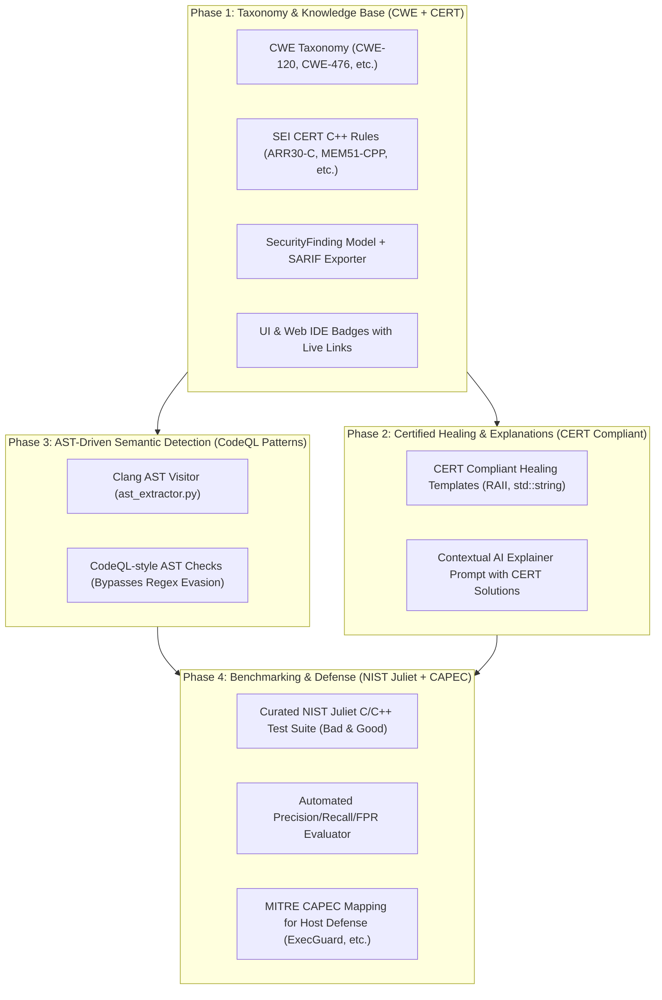

# Comprehensive Implementation Plan: Security Standards & Analysis Integration

> **Standardization & Architecture Enhancement**  
> Integrating MITRE CWE, SEI CERT C++, NIST SARD Juliet Benchmark, CodeQL-style AST Rules, and MITRE CAPEC into the C++ Compiler Error Explainer & Healer platform.

---

## Executive Summary & Architecture Goals

This plan upgrades the project from a heuristic, regex-based tool with self-authored tests into an enterprise-grade, academically defensible Static Application Security Testing (SAST) and automated remediation platform.



---

## Phase 1: Taxonomy & Knowledge Base Layer (MITRE CWE & SEI CERT C++)
**Thing Covered:** Standardized Weakness Metadata, Dual-Taxonomy Mapping, and Interoperable Reporting (SARIF).

### Problem Statement
Currently, `src/security_analyzer.py` emits plain strings (`"Buffer Overflow"`, `"Format String Vulnerability"`). Findings lack industry-standard identifiers, cannot be exported to SARIF, and cannot be linked to authoritative references.

### Implementation Tasks

#### Task 1.1: Define CWE & CERT Metadata Dictionaries
* **Files:**
  - Modify: `src/security_analyzer.py`
  - Test: `tests/test_cwe_cert_mapping.py`
* **Changes:**
  - Create `CWE_DEFINITIONS` dictionary mapping vulnerability types to CWE IDs, titles, descriptions, and MITRE URLs.
  - Create `CERT_DEFINITIONS` dictionary mapping vulnerability types to SEI CERT C++ rule codes (e.g., `ARR30-C`, `STR31-C`, `MEM51-CPP`, `ENV33-C`, `FIO30-C`).
  - Extend the `SecurityFinding` dataclass:
    ```python
    @dataclass(frozen=True)
    class SecurityFinding:
        file: str
        line: int | None
        column: int | None
        severity: Severity
        vulnerability_type: str
        description: str
        recommendation: str
        source: Literal["compiler_diagnostic", "static_scan", "ast_scan"]
        cwe_id: str | None = None
        cwe_name: str | None = None
        cwe_url: str | None = None
        cert_rule: str | None = None
        cert_url: str | None = None
    ```
  - Update all rule tables (`_DIAGNOSTIC_RULES` and static pattern matching) to assign appropriate CWE and CERT metadata automatically.

#### Task 1.2: SARIF 2.1.0 Exporter
* **Files:**
  - Modify: `src/security_analyzer.py`
  - Test: `tests/test_sarif_export.py`
* **Changes:**
  - Implement `export_to_sarif(findings: list[SecurityFinding], run_info: dict) -> dict` generating OASIS SARIF v2.1.0 JSON.
  - Allows GitHub Code Scanning and IDE tools to directly consume findings.

#### Task 1.3: Update UI & Web IDE with CWE & CERT Badges
* **Files:**
  - Modify: `src/security_view.py`
  - Modify: `src/web_server.py`
  - Test: Manual UI launch & pytest web handler test
* **Changes:**
  - In `security_view.py`, update the table columns to include `CWE` and `CERT Standard`.
  - Add clickable hyperlinks that open `https://cwe.mitre.org/data/definitions/<ID>.html` and `https://wiki.sei.cmu.edu/...` in the default browser.
  - In `web_server.py`, render interactive HTML badges for each vulnerability card.

---

## Phase 2: Certified Compliant Remediation & Explanations (SEI CERT C++)
**Thing Covered:** Modern C++ Automated Healing and CERT-Guided AI Diagnostics.

### Problem Statement
`src/security_healer.py` currently uses heuristic C-style replacements (such as `gets` $\rightarrow$ `fgets`, which still risks truncation or missing newlines). Explanations generated by `src/ai_explainer.py` offer generic advice rather than teaching certified modern C++ standards.

### Implementation Tasks

#### Task 2.1: Modernize Deterministic Healing Templates to CERT Standards
* **Files:**
  - Modify: `src/security_healer.py`
  - Test: `tests/test_cert_compliant_healing.py`
* **Changes:**
  - **STR31-C / STR32-C (String Safety):** Replace unsafe C strings and `gets()` with modern `std::string` and `std::getline(std::cin, ...)`.
  - **ARR30-C (Array Bounds):** Replace unbounded arrays with `std::array` / `std::vector` and `.at()` or explicit bounds checks.
  - **MEM51-CPP (Resource Management):** Update `malloc`/`free` or raw `new`/`delete` fixes to employ RAII containers and `std::unique_ptr` / `std::make_unique`.
  - **ENV33-C (System Calls):** Flag `system()` and provide structured replacements or safe process invocation wrappers.

#### Task 2.2: Contextual AI Explainer Prompt with CERT Guidelines
* **Files:**
  - Modify: `src/ai_explainer.py`
  - Modify: `src/error_explainer.py`
  - Test: `tests/test_ai_explainer_cert.py`
* **Changes:**
  - When a security finding has an associated `cwe_id` and `cert_rule`, include CERT C++ Non-Compliant vs. Compliant Solution examples in the LLM context prompt.
  - Ensure the AI response explains *why* the code violates CERT rules and guides the student to write modern C++17/20 code.

---

## Phase 3: AST-Driven Semantic Detection (CodeQL Query Patterns)
**Thing Covered:** Moving Beyond Regex via Clang AST Analysis & Structural Pattern Matching.

### Problem Statement
As documented in `docs/SECURITY_LIMITATIONS.md`:
> *"Text-based detection (not AST): Guards and the healer use regular expressions and lexical text analysis... Macro aliases (`#define G gets`), comments matching `#ifdef NDEBUG`, and scope-unrelated `free()` evade static regex rules."*
While `src/ast_extractor.py` extracts Clang AST JSON for visualization, `src/security_analyzer.py` previously relied only on lexical regexes.

### Implementation Tasks

#### Task 3.1: AST Semantic Node Visitor
* **Files:**
  - Create: `src/ast_security_rules.py`
  - Modify: `src/security_analyzer.py`
  - Test: `tests/test_ast_security_rules.py`
* **Changes:**
  - Implement an AST tree visitor that walks the structured nodes extracted by `ast_extractor.py`.
  - Parse Clang AST JSON representation for `CallExpr`, `DeclRefExpr`, `ArraySubscriptExpr`, `CXXDeleteExpr`, and `VarDecl`.

#### Task 3.2: Implement CodeQL-Inspired Structural Checks
* **Files:**
  - Modify: `src/ast_security_rules.py`
  - Test: `tests/test_ast_security_rules.py`
* **Specific Rules Modeled on CodeQL C++:**
  1. **Unsafe API Call (CodeQL: `cpp/dangerous-function-overflow`):** Resolves calls to dangerous functions even when hidden behind macros (`#define READ gets`), typedefs, or namespace qualifiers (`::std::gets`).
  2. **Constant Array Bounds (CodeQL: `cpp/out-of-bounds-array-access`):** Inspects `ArraySubscriptExpr` against the known constant dimension of the `VarDecl` array, catching literal out-of-bounds accesses without false regex positives.
  3. **Unchecked Return Value on Security APIs (CodeQL: `cpp/uncontrolled-allocation-size`):** Detects function results discarded in expression statements.
  4. **Double Free / Use After Free (CodeQL: `cpp/use-after-free`):** Identifies access to a variable reference (`DeclRefExpr`) that occurs sequentially following a `CXXDeleteExpr` within the same `CompoundStmt`.

---

## Phase 4: Ground-Truth Benchmarking & Platform Threat Model (NIST Juliet + MITRE CAPEC)
**Thing Covered:** Empirical Validation on Standard Test Suites and Platform Defense Threat Taxonomy.

### Problem Statement
1. The project's benchmark suite (`security_bench/`) relied on self-authored test cases, preventing unbiased evaluation against external benchmarks.
2. The platform's 8 defense guards (`src/guard/*`) use custom category names without standardized threat classification.

### Implementation Tasks

#### Task 4.1: Curated NIST SARD Juliet C/C++ Benchmark Suite
* **Files:**
  - Create directory: `security_bench/juliet/`
  - Create test cases:
    - `security_bench/juliet/CWE121_Stack_Based_Buffer_Overflow/` (bad & good)
    - `security_bench/juliet/CWE134_Uncontrolled_Format_String/` (bad & good)
    - `security_bench/juliet/CWE476_NULL_Pointer_Dereference/` (bad & good)
    - `security_bench/juliet/CWE416_Use_After_Free/` (bad & good)
    - `security_bench/juliet/CWE190_Integer_Overflow/` (bad & good)
    - `security_bench/juliet/CWE415_Double_Free/` (bad & good)
  - Create benchmark runner: `security_bench/run_juliet_benchmark.py`
  - Test: `python security_bench/run_juliet_benchmark.py`
* **Metrics Computed:**
  - **True Positive Rate (Recall)** on `bad()` functions.
  - **False Positive Rate (FPR)** on `good()` functions.
  - **Healing Success Rate** on Juliet flawed samples.

#### Task 4.2: MITRE CAPEC Threat Taxonomy for Platform Guards
* **Files:**
  - Modify: `src/guard/models.py`
  - Modify: `src/guard/attack_log.py`
  - Modify: `src/guard/supervisor.py`
  - Modify: `docs/SECURITY_ARCHITECTURE.md`
  - Test: `tests/test_capec_taxonomy.py`
* **Changes:**
  - Add `capec_id` and `capec_name` to `Finding` and `AttackEvent`.
  - Map each guard agent to official CAPEC patterns:
    - `ExecGuard` $\rightarrow$ **CAPEC-88 (OS Command Injection)**, **CAPEC-6 (Argument Injection)**
    - `PromptGuard` $\rightarrow$ **CAPEC-690 (LLM Prompt Injection)**
    - `ResourceGuard` $\rightarrow$ **CAPEC-130 (Excessive Allocation)**, **CAPEC-197 (Macro Bomb)**
    - `EndpointGuard` $\rightarrow$ **CAPEC-137 (Parameter Tampering)**, **CAPEC-62 (Cross-Site Request Forgery)**
    - `OutputGuard` $\rightarrow$ **CAPEC-242 (Display / Script Injection)**
    - Obfuscation $\rightarrow$ **CAPEC-24 (Filter Failure via Alternate Encoding)**
  - Update `docs/SECURITY_ARCHITECTURE.md` with the verified CAPEC threat matrix.

---

## Deliverables & Verification Checklist

| Phase | Core Deliverable | Verification Command |
| :--- | :--- | :--- |
| **Phase 1** | `SecurityFinding` CWE & CERT attributes + SARIF exporter | `pytest tests/test_cwe_cert_mapping.py tests/test_sarif_export.py` |
| **Phase 2** | CERT-compliant healing templates in `security_healer.py` | `pytest tests/test_cert_compliant_healing.py` |
| **Phase 3** | AST-based CodeQL-style rules in `src/ast_security_rules.py` | `pytest tests/test_ast_security_rules.py` |
| **Phase 4** | NIST Juliet benchmark evaluation & CAPEC threat mapping | `python security_bench/run_juliet_benchmark.py` |
